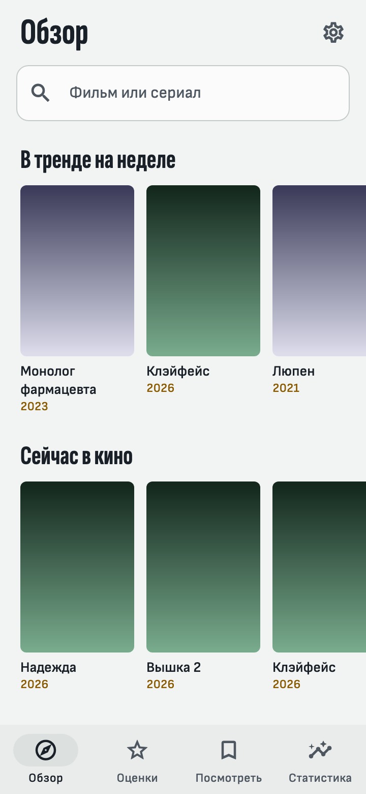
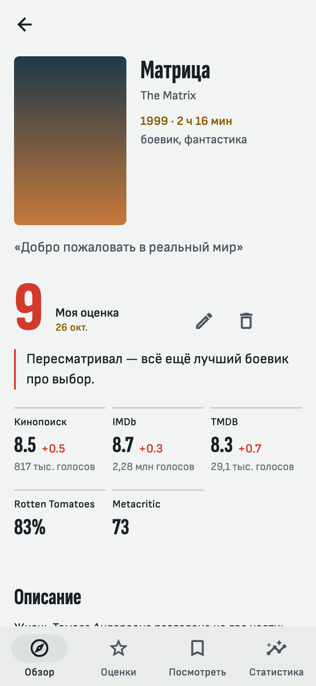
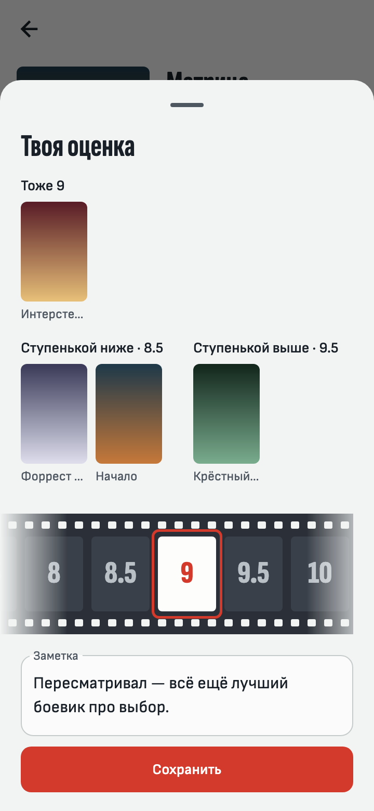
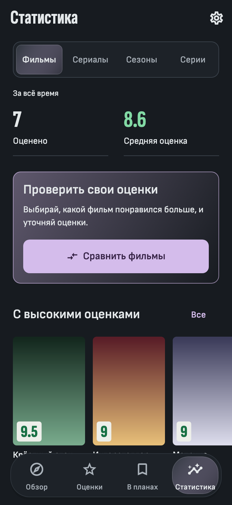

# Framebook

A personal film and TV diary for keeping your own ratings and comparing them
with public scores. Ratings, notes and watchlists live on the device; optional
sync uses your own Google Drive. There is no Framebook account or backend.

## Features

- Search films, series and people, browse title cards and filmographies.
- Rate films, series, seasons and episodes independently, with notes and
  comparisons against your earlier ratings.
- Compare with Kinopoisk, IMDb, TMDB, Rotten Tomatoes and Metacritic.
- Keep a watchlist, favourite people and explore personal recommendations.
- Explore statistics by score, genre, decade and contributor; calibrate movie
  scores through guided pair comparisons.
- Use saved library data offline; sync, back up, export and import it.
- Choose English or Russian and a light or dark theme.

  
  
  
  

Screenshots use stand-in posters rendered by the app's screenshot tests.

## Install

Download the universal Android APK from
[GitHub Releases](https://github.com/tiltozavr2545/Framebook/releases).
Install an update over the existing app to retain its data.
The [API key guide](docs/api-keys.md) explains first-launch setup
([Russian translation](docs/api-keys.ru.md)).

Android is the supported platform. The MVP is implemented; remaining validation
and current work are tracked in the [implementation plan](docs/implementation-plan.md).
Released changes are recorded in the [changelog](CHANGELOG.md).

## Development

The app uses Flutter, Riverpod, go_router and SQLite through Drift.
Source code is under `app/`; automation is in `Makefile`, `scripts/` and
`.github/workflows/`.

Follow the [development guide](docs/development.md) for SDK requirements,
local setup and generated code. Signing, OAuth and release publication are
covered by [operations](docs/operations.md).

## Documentation

The [documentation index](docs/README.md) lists the main document for each
topic, including product behavior, architecture, storage, sources, sync,
recommendations, testing and review reports. Agent instructions are in
[AGENTS.md](AGENTS.md).
